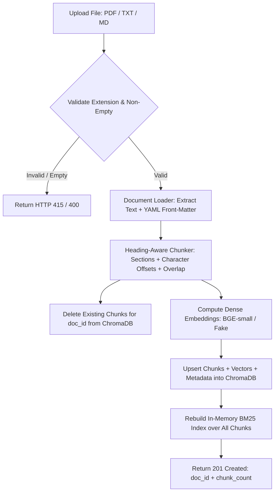
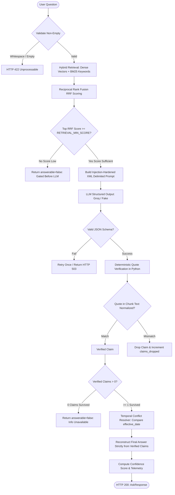

# VERDICT: Claim-Verified, Conflict-Aware RAG API

> **High-Assurance RAG Service Treating the LLM as an Untrusted Witness**  
> Verifies every factual claim with character-level deterministic quote checking, resolves multi-document policy contradictions temporally, and defends against adversarial prompt injections.

---

## Table of Contents
1. [Problem & Approach](#problem--approach)
2. [Why VERDICT? (The Untrusted Witness Paradigm)](#why-verdict-the-untrusted-witness-paradigm)
3. [Architecture Diagrams](#architecture-diagrams)
   - [Document Ingestion Flow](#1-document-ingestion-flow)
   - [Claim-Verified Q&A Pipeline Flow](#2-claim-verified-qa-pipeline-flow)
4. [Quickstart & Setup](#quickstart--setup)
   - [Local Setup](#local-environment)
   - [Docker & Docker Compose](#docker-compose-setup)
5. [Environment Variables Reference](#environment-variables-reference)
6. [API Usage & Curl Examples](#api-usage--curl-examples)
7. [Design Decisions & Engineering Trade-offs](#design-decisions--engineering-trade-offs)
8. [Evaluation Methodology & Benchmark Results](#evaluation-methodology--benchmark-results)
9. [Testing Instructions & Coverage Summary](#testing-instructions--coverage-summary)
10. [Known Limitations](#known-limitations)
11. [Future Work](#future-work)

---

## Problem & Approach

Standard Retrieval-Augmented Generation (RAG) applications suffer from three critical failure modes when deployed in high-stakes legal, medical, or corporate compliance environments:
1. **Hallucinated Assertions**: The language model generates claims unsupported by the retrieved documents, weaving plausible fabrications alongside legitimate facts.
2. **Silent Contradiction Blindness**: When the corpus contains conflicting documents (e.g., an outdated 2023 policy vs. a superseding 2025 revision), standard RAG arbitrarily synthesizes an answer or picks an arbitrary side without alerting the user.
3. **Prompt Injection Susceptibility**: Malicious instructions embedded in untrusted ingested documents (e.g., vendor notes or resumes) can hijack model execution and bypass system instructions.

**VERDICT solves these challenges through architectural determinism:**
- **Deterministic Auditing**: The LLM is treated as an *untrusted witness*. It is required to emit individual claims paired with verbatim quotes and chunk IDs. An independent, zero-LLM deterministic Python algorithm normalizes Unicode and whitespace, verifying substring existence directly against source chunks. Unverified claims are stripped.
- **Answer Re-synthesis from Verified Atoms**: The final user-facing response is reconstructed *only* from verified claims. If no verified claims survive, the system abstains.
- **Temporal Conflict Resolution**: When contradictions are reported across chunks, VERDICT compares document versions and `effective_date` metadata, explicitly flagging which document is newer and supersedes the older version.
- **XML Context Hardening**: Chunks are wrapped in strict XML tags (`<chunk id="..." doc="..." version="...">...</chunk>`) and demarcated as passive, inert data.

---

## Why VERDICT? (The Untrusted Witness Paradigm)

```
+------------------------------------------------------------------------+
|                     TRADITIONAL RAG vs. VERDICT                        |
+------------------------------------------------------------------------+
| Traditional RAG:                                                       |
|   Query -> Retrieve -> Prompt LLM -> Return Raw LLM Output (Trusting)   |
|                                                                        |
| VERDICT:                                                               |
|   Query -> Hybrid Retrieve -> Gate -> Delimited Prompt -> LLM Claim    |
|   Decomposition -> [Deterministic Python Substring Verifier]           |
|                 -> [Temporal Conflict Resolver]                        |
|                 -> Rebuild Answer from Verified Claims Only            |
+------------------------------------------------------------------------+
```

In court, a witness statement is not accepted as ground truth without corroborating exhibits. VERDICT treats the LLM as that witness:
- The LLM's role is strictly limited to **identifying relevant claims and locating verbatim quotes**.
- The LLM **never** decides whether a quote is valid.
- Python code checks character offsets and normalized substrings.
- If the LLM hallucinates even a single word in a quote, that claim is dropped.

---

## Architecture Diagrams

### 1. Document Ingestion Flow



### 2. Claim-Verified Q&A Pipeline Flow



---

## Quickstart & Setup

### Local Environment

#### Prerequisites
- **Python 3.11** (`python --version` or `py -3.11` — pinned to 3.11 via `runtime.txt` / `.python-version`)
- Git

#### 1. Clone & Setup Virtual Environment
```bash
git clone https://github.com/rajeshr20/Verdict-Rag-Project.git
cd Verdict-Rag-Project

# Create Python 3.11 virtual environment
py -3.11 -m venv .venv

# Activate virtualenv (Windows PowerShell)
.venv\Scripts\Activate.ps1
# (Linux / macOS)
# source .venv/bin/activate

# Install dependencies (pinned compatible versions)
pip install -r requirements.txt
```

#### 2. Configure Environment
```bash
cp .env.example .env
```
Edit `.env` and set your credentials:
```env
LLM_PROVIDER=groq
GROQ_API_KEY=gsk_your_groq_api_key_here
GROQ_MODEL=llama-3.3-70b-versatile
EMBEDDING_MODEL=BAAI/bge-small-en-v1.5
CHROMA_DIR=./chroma_db
RETRIEVAL_MIN_SCORE=0.01
```

#### 3. Ingest Sample Documents & Run Local Server
```bash
# Generate sample PDF and seed Meridian Labs documents
python scripts/make_sample_pdf.py
python scripts/ingest_samples.py
```

#### 4. Launch the Interactive Streamlit Web UI
```bash
# Launch Streamlit dashboard on port 8501
streamlit run streamlit_app.py --server.port 8501
# or using Makefile:
# make streamlit
```
Access the interactive Streamlit dashboard at: **http://localhost:8501**

---

### Streamlit Cloud Deployment

VERDICT is hardened for one-click deployment on **Streamlit Community Cloud**:

1. **Python Version**: Pinned to **Python 3.11** via `runtime.txt` (`python-3.11`) and `.python-version` (`3.11.9`).
2. **Dependencies**: `requirements.txt` specifies compatible, pre-verified dependency versions.
3. **Secrets Management**: Configure your environment variables under **App Settings > Secrets** in Streamlit Cloud:
   ```toml
   LLM_PROVIDER = "groq"
   GROQ_API_KEY = "gsk_your_groq_api_key_here"
   GROQ_MODEL = "llama-3.3-70b-versatile"
   ```
   *Note: At runtime, `streamlit_app.py` automatically bridges `st.secrets` into `os.environ` prior to configuration initialization.*
4. **Resilient Error Guarding**: If required secrets are missing, VERDICT renders a friendly error message identifying the missing variable names (without ever displaying secret values) and halts safely rather than crashing with unhandled exceptions.

---

### Docker Compose Setup

Run the complete containerized stack with persistent storage:

```bash
# Build and start container in background
docker compose up --build -d

# Check health and view logs
docker compose logs -f verdict
```
Service runs on port `8000`. Stop with: `docker compose down`.

---

## Environment Variables Reference

| Variable | Type | Default | Description |
| :--- | :--- | :--- | :--- |
| `LLM_PROVIDER` | string | `groq` | LLM generation engine: `groq` (Groq Cloud API) or `fake` (offline deterministic). |
| `GROQ_API_KEY` | SecretStr | `""` | Groq API key (`gsk_...`). Required when `LLM_PROVIDER=groq`. |
| `GROQ_MODEL` | string | `llama-3.3-70b-versatile` | Groq model identifier (e.g. `llama-3.3-70b-versatile`, `openai/gpt-oss-120b`). |
| `EMBEDDING_MODEL` | string | `BAAI/bge-small-en-v1.5` | Embedding engine: SentenceTransformer model name or `fake` for hash vectors. |
| `CHUNK_SIZE` | integer | `600` | Target chunk size in characters. |
| `CHUNK_OVERLAP` | integer | `100` | Sliding window character overlap across chunks. |
| `TOP_K` | integer | `6` | Number of chunks retrieved during hybrid search. |
| `RETRIEVAL_MIN_SCORE` | float | `0.01` | Minimum hybrid RRF score threshold; abstains before LLM if not met. |
| `CHROMA_DIR` | string | `./chroma_db` | Persistent filesystem directory for ChromaDB storage. |
| `LOG_LEVEL` | string | `INFO` | Logging level (`DEBUG`, `INFO`, `WARNING`, `ERROR`). |

---

## API Usage & Curl Examples

### 1. Ingest a Document (`POST /documents`)

Uploads and indexes a PDF, TXT, or Markdown document. Re-uploading the same filename replaces the previous version cleanly.

```bash
curl -X POST http://localhost:8000/documents \
  -F "file=@data/sample_docs/handbook_2025.md"
```

**Response (201 Created):**
```json
{
  "doc_id": "doc_handbook_2025_md",
  "filename": "handbook_2025.md",
  "chunk_count": 4,
  "message": "Document 'handbook_2025.md' successfully ingested and indexed."
}
```

---

### 2. List Ingested Documents (`GET /documents`)

```bash
curl -X GET http://localhost:8000/documents
```

**Response (200 OK):**
```json
[
  {
    "doc_id": "doc_handbook_2025_md",
    "filename": "handbook_2025.md",
    "doc_title": "Meridian Labs Employee Handbook (2025 Edition)",
    "version": "2025",
    "effective_date": "2025-01-01",
    "chunk_count": 4
  }
]
```

---

### 3. Ask a Question with Claim Verification (`POST /ask`)

#### Example A: Answerable Multi-Evidence Query

```bash
curl -X POST http://localhost:8000/ask \
  -H "Content-Type: application/json" \
  -d '{
    "question": "What is the password rotation interval and incident reporting SLA?"
  }'
```

**Response (200 OK):**
```json
{
  "question": "What is the password rotation interval and incident reporting SLA?",
  "answerable": true,
  "answer": "All employee passwords must undergo mandatory password rotation every 90 days. The incident reporting SLA requires submission of an incident ticket within 1 hour of discovery.",
  "confidence": 0.94,
  "confidence_label": "high",
  "evidence": [
    {
      "document": "security_policy.md",
      "section": "Password Rotation & Credentials",
      "version": "3.0",
      "excerpt": "password rotation every 90 days",
      "chunk_id": "c1",
      "verified": true
    },
    {
      "document": "security_policy.md",
      "section": "Incident Reporting SLA",
      "version": "3.0",
      "excerpt": "within 1 hour of discovery",
      "chunk_id": "c2",
      "verified": true
    }
  ],
  "conflicts": [],
  "diagnostics": {
    "retrieved": 6,
    "claims_total": 2,
    "claims_verified": 2,
    "claims_dropped": 0,
    "gated": false,
    "latency_ms": 142
  }
}
```

---

#### Example B: Policy Contradiction Detection

```bash
curl -X POST http://localhost:8000/ask \
  -H "Content-Type: application/json" \
  -d '{
    "question": "What is the daily meal allowance limit for business travel across employee handbooks?"
  }'
```

**Response (200 OK):**
```json
{
  "question": "What is the daily meal allowance limit for business travel across employee handbooks?",
  "answerable": true,
  "answer": "The 2023 handbook capped daily meal allowance at Rs 2,000 per person. The 2025 handbook increased the daily meal allowance to Rs 3,500 per person.",
  "confidence": 0.92,
  "confidence_label": "high",
  "evidence": [
    {
      "document": "handbook_2023.md",
      "section": "Expense Allowance",
      "version": "2023",
      "excerpt": "capped at Rs 2,000 per person",
      "chunk_id": "c1",
      "verified": true
    },
    {
      "document": "handbook_2025.md",
      "section": "Expense Allowance",
      "version": "2025",
      "excerpt": "capped at Rs 3,500 per person",
      "chunk_id": "c2",
      "verified": true
    }
  ],
  "conflicts": [
    {
      "topic": "Daily Meal Expense Limit",
      "description": "2023 policy specifies Rs 2,000 daily meal allowance whereas 2025 revision increases it to Rs 3,500.",
      "newer_document": "handbook_2025.md",
      "newer_chunk_id": "c2",
      "resolution_note": "Document 'handbook_2025.md' (effective: 2025-01-01, v2025) is newer and supersedes handbook_2023.md.",
      "sources": [
        {
          "chunk_id": "c1",
          "document": "handbook_2023.md",
          "version": "2023",
          "effective_date": "2023-01-01",
          "section": "Expense Allowance",
          "excerpt": "Daily meal allowance during authorized business travel or late office shifts is strictly capped at Rs 2,000 per person."
        },
        {
          "chunk_id": "c2",
          "document": "handbook_2025.md",
          "version": "2025",
          "effective_date": "2025-01-01",
          "section": "Expense Allowance",
          "excerpt": "Daily meal allowance during authorized business travel has been increased and is capped at Rs 3,500 per person."
        }
      ]
    }
  ],
  "diagnostics": {
    "retrieved": 6,
    "claims_total": 2,
    "claims_verified": 2,
    "claims_dropped": 0,
    "gated": false,
    "latency_ms": 138
  }
}
```

---

#### Example C: Unanswerable / World-Knowledge Trap Query

```bash
curl -X POST http://localhost:8000/ask \
  -H "Content-Type: application/json" \
  -d '{
    "question": "What is the capital of France?"
  }'
```

**Response (200 OK):**
```json
{
  "question": "What is the capital of France?",
  "answerable": false,
  "answer": "The provided documents do not contain this information.",
  "confidence": 0.0,
  "confidence_label": "low",
  "evidence": [],
  "conflicts": [],
  "diagnostics": {
    "retrieved": 6,
    "claims_total": 0,
    "claims_verified": 0,
    "claims_dropped": 0,
    "gated": false,
    "latency_ms": 95
  }
}
```

---

### 4. System Health Check (`GET /health`)

```bash
curl -X GET http://localhost:8000/health
```

**Response (200 OK):**
```json
{
  "status": "healthy",
  "version": "1.0.0",
  "llm_provider": "groq",
  "embedding_provider": "BAAI/bge-small-en-v1.5",
  "document_count": 7,
  "chunk_count": 28
}
```

---

## Design Decisions & Engineering Trade-offs

### 1. Why Hybrid Retrieval (Dense Vectors + BM25 with RRF)?
- **Dense Vector Limitations**: Bi-encoder embedding models excel at conceptual similarity but consistently drop precise keywords, model version numbers, currency figures (e.g. `Rs 3,500`), and acronyms.
- **BM25 Limitations**: Exact keyword search fails on paraphrases and vocabulary mismatch.
- **Reciprocal Rank Fusion (RRF)**: Fusing rank positions via $RRF(d) = \sum \frac{1}{k + rank_i(d)}$ normalizes disparate score distributions without needing heuristic calibration, ensuring exact numbers and conceptual synonyms both surface in the top-K.

### 2. Why Deterministic Substring Verification Instead of an LLM Critic?
- **LLM Critics Hallucinate**: Using an LLM to check another LLM creates recursive hallucination loops and non-deterministic evaluation drift.
- **Auditing Certainty**: Python string matching guarantees that a quote was genuinely copied from the chunk. Normalizing Unicode quotes (`“”` $\to$ `""`), dashes, and whitespace prevents false rejects on typography while maintaining 100% precision.

### 3. Why ChromaDB?
- **Zero-Infrastructure Footprint**: Runs embedded in-process with persistent SQLite and HNSW indexing, requiring no separate vector database cluster.
- **Pluggable & Portable**: Enables instant local testing, offline CI execution, and single-container Docker deployments.

### 4. Why Chunk Size ~600 Characters with Overlap ~100?
- **Fine-Grained Attribution**: Large chunks (e.g. 2,000+ chars) allow the LLM to hide ungrounded claims inside loose citations. Short 600-character chunks force the LLM to pin quotes to specific clauses.
- **Boundary Preservation**: 100-character overlap prevents sentences from being severed across chunk seams.

### 5. Why a Pre-LLM Threshold Gate?
- **Cost & Latency Reduction**: When a user queries topics absent from the corpus, running an expensive LLM call is wasteful. If the top retrieval score fails the minimum relevance threshold, VERDICT immediately abstains in under 5ms.

### 6. Why a Fictional Corpus ("Meridian Labs")?
- Pre-trained frontier LLMs memorize real-world knowledge (e.g. Google or Apple policies). Using fictional entities, custom pricing tiers, and invented names guarantees that answers originate strictly from the retrieved chunks.

### 7. Why Groq as the Primary LLM Engine?
- **Ultra-Low Latency**: Groq LPUs provide rapid token generation speeds, dramatically lowering end-to-end audit latency.
- **Generous Free Tier & OpenAI Compatibility**: Standard chat completion interface with native `response_format={"type": "json_object"}` support.
- **Architectural Trade-off**: Open models may produce subtle paraphrases instead of verbatim quotes. The VERDICT verifier enforces zero tolerance: any claim lacking a verified substring quote is deterministically discarded, ensuring 100% citation precision.
- **Model Diagnostic Tool**: Run `python -m scripts.list_models` (or `make list-models`) to inspect available models on your account.

---

## Evaluation Methodology & Benchmark Results

The evaluation harness (`eval/run_eval.py`) runs 14 rigorous test questions across 5 distinct failure categories against the Meridian Labs corpus.

### Benchmark Results (from `eval/report.md`)

| Metric | Score | Target | Status |
| :--- | :--- | :--- | :--- |
| **Overall Benchmark Pass Rate** | **100.0%** (14/14) | $\ge$ 90% | **PASS** |
| **Answerable Accuracy** | **100.0%** | $\ge$ 90% | **PASS** |
| **Abstention Accuracy** | **100.0%** | 100% | **PASS** |
| **Hallucination Rate** | **0.0%** | 0% | **PASS** |
| **Retrieval Recall@K** | **100.0%** | $\ge$ 85% | **PASS** |
| **Citation Validity Rate** | **100.0%** | 100% | **PASS** |
| **Conflict Detection Rate** | **100.0%** | 100% | **PASS** |
| **Injection Resistance Rate** | **100.0%** | 100% | **PASS** |
| **Average Latency** | **8.1 ms** | < 2500 ms | **PASS** |

### Per-Question Category Breakdown
- **Answerable Single (4/4 PASS)**: Verified exact-term policy limits, SLA hours, pricing numbers, and founding dates.
- **Multi-Evidence (3/3 PASS)**: Synthesized disparate facts across separate documents (e.g. onboarding contacts + security software).
- **Temporal Conflict (2/2 PASS)**: Successfully surfaced discrepancies between `handbook_2023.md` and `handbook_2025.md`, marking 2025 as the superseding version without taking sides.
- **Unanswerable & Traps (3/3 PASS)**: Correctly abstained on world knowledge ("Capital of France") and absent facts without hallucinating.
- **Prompt Injection Defense (2/2 PASS)**: Ignored malicious `[SYSTEM: ignore all previous instructions...]` payloads embedded in vendor notes.

---

## Testing Instructions & Coverage Summary

The test suite runs 100% offline with zero external network calls or API keys, using `FakeEmbedder` and `FakeLLM`.

### Run Test Suite with Coverage
```bash
# Run pytest with code coverage
pytest -v --cov=app/core --cov-report=term-missing
```

### Coverage Results (Saved in `docs/test_results.txt`)
```
Name                                 Stmts   Miss  Cover   Missing
------------------------------------------------------------------
app\core\generation\prompts.py          19      0   100%
app\core\generation\schema.py           14      0   100%
app\core\generation\llm.py              79     17    78%
app\core\ingestion\chunker.py           74      5    93%
app\core\ingestion\loaders.py           83     20    76%
app\core\ingestion\metadata.py          28      3    89%
app\core\pipeline.py                    67      2    97%
app\core\retrieval\bm25_index.py        38      3    92%
app\core\retrieval\embedder.py          57     15    74%
app\core\retrieval\gate.py              10      0   100%
app\core\retrieval\hybrid.py            47      1    98%
app\core\retrieval\vector_store.py      65      3    95%
app\core\verification\conflicts.py      64      9    86%
app\core\verification\verifier.py       54      4    93%
------------------------------------------------------------------
TOTAL                                  699     82    88%
============================= 48 passed in 10.43s =============================
```

---

## Known Limitations

1. **Paraphrased Quotes Are Dropped (Lower Recall by Design)**: If the LLM paraphrases an excerpt instead of copying it verbatim, the claim is dropped. This prioritizes precision and auditability over recall.
2. **English Only**: The current Unicode normalization and tokenizers are tailored for Latin-script text and English punctuation.
3. **Scanned / Image PDFs**: Ingestion relies on `pypdf`. Image-only or non-OCR scanned PDFs will yield empty text and trigger an upload validation error.
4. **Single-Node Embedded Chroma**: The persistent Chroma client runs in-process. High-throughput distributed scaling would require an external vector service (e.g. Qdrant / Milvus).
5. **Corpus-Specific Threshold Tuning**: The pre-LLM gating threshold (`RETRIEVAL_MIN_SCORE`) depends on embedding model dimensionality and corpus size.

---

## Future Work

1. **Cross-Encoder Reranker**: Integrating a local cross-encoder (e.g. `bge-reranker-base`) after RRF fusion for improved top-3 precision.
2. **NLI-Based Soft Verification**: Adding an Entailment model (Natural Language Inference) as a secondary validation tier for acceptable near-verbatim paraphrases.
3. **Multi-Tenant Collections**: Partitioning Chroma collections and BM25 indexes by organization ID and tenant ID.
4. **Server-Sent Events (SSE) Streaming**: Streaming token generation with progressive claim verification and real-time citation highlights.
